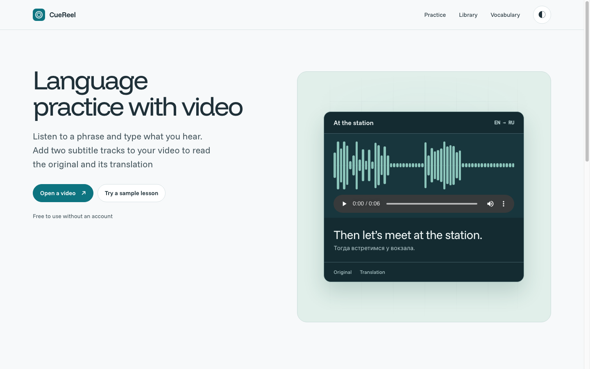

<div align="center">



# CueReel

**Sprachen mit eigenen Videos, Audiodateien und Untertiteln lernen**

[](LICENSE)
[](https://developer.mozilla.org/en-US/docs/Web/JavaScript/Guide/Modules)
[](https://www.w3.org/TR/webvtt1/)
[](.github/workflows/pages.yml)

[English](README.md) · [Українська](README.uk.md) · [Slovenčina](README.sk.md) · **Deutsch** · [Русский](README.ru.md)

</div>

---

## Überblick

Sieh dir Videos mit synchronisierten Untertiteln an, tippe den sichtbaren Satz ab oder übe mit einem Diktat. Die Anwendung läuft im Browser ohne Konto und ohne Zeitlimit pro Sitzung

---

## Funktionen

| | Funktion | Details |
|---|---|---|
| ▶️ | **Medien** | Lokale Dateien, direkte URLs, YouTube, Vimeo, PeerTube und Internet Archive |
| 🌐 | **Untertitel** | Original und Übersetzung aus SRT, WebVTT oder unterstützten eingebetteten Textspuren. Text und Zeitmarken bearbeiten und als SRT oder WebVTT exportieren |
| 🎙️ | **Transkription** | Das mehrsprachige Whisper Base Q5 erzeugt auf dem Gerät eine Originalspur mit Zeitmarken |
| ⌨️ | **Übungen** | Rückmeldung beim Tippen, automatischer Wechsel nach einer richtigen Antwort, Tipps fürs Diktat und optionale Tipp- und Fehlertöne |
| 📊 | **Fortschritt** | Abgeschlossene Sätze, Genauigkeit und Hörzeit. Vokabelkarten speichern und nach einem Zeitplan wiederholen |
| 💾 | **Speicherung** | Aktuellen Arbeitsstand automatisch wiederherstellen, Lektionen separat in der Bibliothek speichern und die Bibliothek als JSON-Sicherung übertragen |
| ◐ | **Darstellung** | Englische Oberfläche mit hellem und dunklem Design |

---

## Erste Schritte

```bash
python3 -m http.server 8000 --bind 127.0.0.1
```

Führe den Befehl im Projektordner aus und öffne [127.0.0.1:8000](http://127.0.0.1:8000). Wähle **Try a sample lesson** oder füge unter **Lesson materials** eine Mediendatei hinzu

---

## Lokale Untertitel und YouTube

Wähle für eine lokale Video- oder Audiodatei ohne Untertitel **Generate subtitles**. Beim ersten Start lädt der Browser etwa 60 MB Whisper-Modellgewichte und speichert sie, sofern möglich, im Cache. Der Ton bleibt auf deinem Gerät. Unter **Edit subtitles** kannst du das Ergebnis prüfen

Füge einen Link zu einem YouTube-Video, Short oder youtu.be unter **Video or audio URL** ein und klicke auf **Open link**. Wähle auf YouTube **Show transcript**, sofern verfügbar. Füge den Text mit Zeitmarken unter **Paste YouTube transcript** ein und wähle **Use as original** oder **Use as translation**. Öffne bei einem Video ohne Untertitel eine lokale Kopie mit Whisper

---

## Übungen und Speicherung

**Subtitle typing** und **Dictation** akzeptieren Antworten mit oder ohne Satzzeichen. Aktiviere **Typing sounds**, um bei einem abweichenden Zeichen einen anderen Ton zu hören

Nach dem Neuladen werden Medien, Spuren, Position, Modus, Antwort und Fortschritt im selben Browser unter derselben Adresse wiederhergestellt. **Save lesson** speichert eine benannte Kopie in der Bibliothek. Eine **Library backup** enthält Untertitel, Fortschritt und Vokabeln. Verknüpfe lokale Dateien nach einem Import in einen anderen Browser erneut

---

## Technik und Veröffentlichung

Die Anwendung nutzt HTML, CSS, JavaScript-Module, IndexedDB, Web Audio und eine WebAssembly-Version von whisper.cpp. Wähle für GitHub Pages **Settings → Pages → Source → GitHub Actions** und starte **Deploy GitHub Pages**. Der [Workflow](.github/workflows/pages.yml) kopiert die statischen Dateien und die Laufzeitumgebung

---

## Einschränkungen

- YouTube und Vimeo müssen das Einbetten erlauben. Der Download über die [offizielle YouTube-Untertitel-API](https://developers.google.com/youtube/v3/docs/captions/download) erfordert die Berechtigung, das Video zu bearbeiten
- Whisper benötigt WebAssembly SIMD und einen Browser, der den Audio-Codec der Quelle dekodieren kann. Lange Dateien können mehr Zeit und Speicher benötigen
- Die lokale Bibliothek ist durch den Browserspeicher begrenzt. Zugriff auf externe Dateien und Untertitel sowie das Springen im Video hängen von der Quelle ab

## Ausblick

- [ ] Weitere Plattformadapter und Untertitelquellen

## Lizenz

[MIT](LICENSE)
