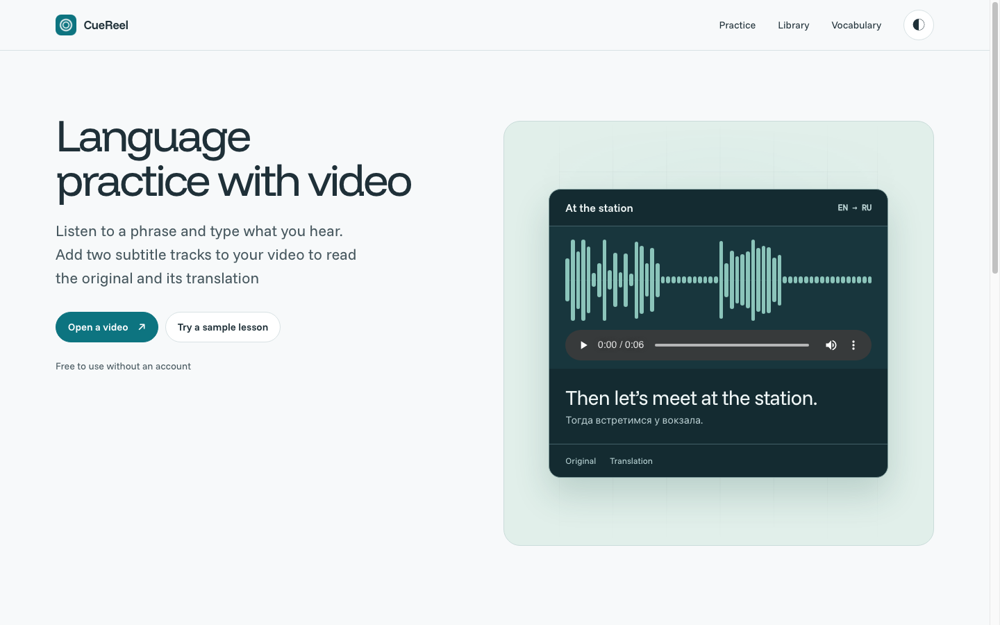

<div align="center">



# CueReel

**Practice languages with your own video, audio, and subtitles**

**[Try CueReel online](https://jarryuser.github.io/CueReel/)**

[](LICENSE)
[](https://developer.mozilla.org/en-US/docs/Web/JavaScript/Guide/Modules)
[](https://www.w3.org/TR/webvtt1/)
[](.github/workflows/pages.yml)

**English** · [Українська](README.uk.md) · [Slovenčina](README.sk.md) · [Deutsch](README.de.md) · [Русский](README.ru.md)

</div>

---

## Overview

Watch with synchronized subtitles, type a visible phrase, or practice dictation. The app runs in the browser without an account or a session time limit

---

## Features

| | Feature | Details |
|---|---|---|
| ▶️ | **Media** | Local files, direct URLs, YouTube, Vimeo, PeerTube, and Internet Archive |
| 🌐 | **Subtitles** | Original and translation from SRT, WebVTT, or supported embedded text tracks. Edit text and timecodes, then export SRT or WebVTT |
| 🎙️ | **Transcription** | Multilingual Whisper Base Q5 generates an original track with timestamps on the device |
| ⌨️ | **Practice** | Live typing feedback, automatic advance after a correct answer, dictation hints, and optional typing and error sounds |
| 📊 | **Progress** | Track completed phrases, accuracy, and listening time. Save vocabulary cards and review them on a schedule |
| 💾 | **Storage** | Automatically resume the current workspace, save separate lessons in the library, and transfer the library with a JSON backup |
| ◐ | **Appearance** | English interface with light and dark themes |

---

## Getting started

```bash
python3 -m http.server 8000 --bind 127.0.0.1
```

Run the command from the project folder and open [127.0.0.1:8000](http://127.0.0.1:8000). Choose **Try a sample lesson** or add media in **Lesson materials**

---

## Local subtitles and YouTube

For a local video or audio file without subtitles, select **Generate subtitles**. The first run downloads about 60 MB of Whisper weights, cached when browser storage is available. Audio stays on your device. **Edit subtitles** opens the generated track for review

For YouTube, paste a watch, Shorts, or youtu.be link into **Video or audio URL** and choose **Open link**. On YouTube, use **Show transcript** if available. Paste the text with timestamps into **Paste YouTube transcript** and select **Use as original** or **Use as translation**. For a video without captions, open a local copy to use Whisper

---

## Practice and storage

**Subtitle typing** and **Dictation** both accept answers with or without punctuation. Turn on **Typing sounds** to hear a different sound for a key that does not match

Reloading restores the current media, tracks, position, mode, answer, and progress on the same browser and site. **Save lesson** keeps a named copy in the library. A **Library backup** includes subtitles, progress, and vocabulary. Reconnect local media after importing it into another browser

---

## Tech stack and publishing

The app uses HTML, CSS, JavaScript modules, IndexedDB, Web Audio, and whisper.cpp compiled to WebAssembly. For GitHub Pages, set **Settings → Pages → Source** to **GitHub Actions**, then run **Deploy GitHub Pages**. The [workflow](.github/workflows/pages.yml) copies the static files and bundled runtime

---

## Limitations

- YouTube and Vimeo require permission to embed the video. YouTube’s [official caption download API](https://developers.google.com/youtube/v3/docs/captions/download) requires permission to edit the video
- Whisper requires browser support for WebAssembly SIMD and for the source audio codec. Long files can take more time and memory
- Browser storage limits affect local lessons. Remote files and subtitle URLs depend on the provider’s browser access and seeking support

## Roadmap

- [ ] More platform adapters and caption sources

## License

[MIT](LICENSE)
