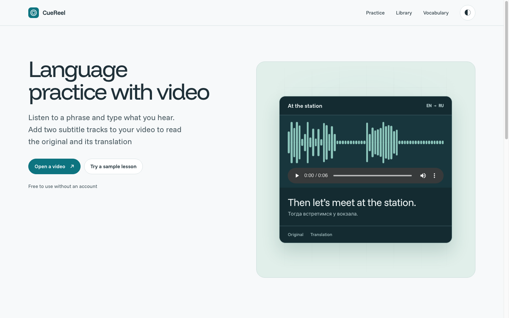

<div align="center">



# CueReel

**Изучайте языки по собственным видео, аудио и субтитрам**

[](LICENSE)
[](https://developer.mozilla.org/en-US/docs/Web/JavaScript/Guide/Modules)
[](https://www.w3.org/TR/webvtt1/)
[](.github/workflows/pages.yml)

[English](README.md) · [Українська](README.uk.md) · [Slovenčina](README.sk.md) · [Deutsch](README.de.md) · **Русский**

</div>

---

## Обзор

Смотрите видео с синхронизированными субтитрами, набирайте видимую фразу или тренируйте диктант. Приложение работает в браузере без регистрации и ограничения времени занятия

---

## Возможности

| | Возможность | Подробности |
|---|---|---|
| ▶️ | **Медиа** | Локальные файлы, прямые ссылки, YouTube, Vimeo, PeerTube и Internet Archive |
| 🌐 | **Субтитры** | Оригинал и перевод из SRT, WebVTT или поддерживаемых встроенных текстовых дорожек. Редактирование текста и таймкодов, экспорт в SRT или WebVTT |
| 🎙️ | **Распознавание** | Многоязычная Whisper Base Q5 создаёт на устройстве оригинальную дорожку с таймкодами |
| ⌨️ | **Упражнения** | Проверка при вводе, автоматический переход после правильного ответа, подсказки в диктанте и опциональные звуки клавиш и ошибок |
| 📊 | **Прогресс** | Пройденные фразы, точность и время прослушивания. Сохранение слов в карточки и повторение по расписанию |
| 💾 | **Хранение** | Автоматическое восстановление текущего урока, отдельные записи в библиотеке и перенос библиотеки через резервную копию JSON |
| ◐ | **Оформление** | Английский интерфейс со светлой и тёмной темами |

---

## Быстрый старт

```bash
python3 -m http.server 8000 --bind 127.0.0.1
```

Выполните команду в папке проекта и откройте [127.0.0.1:8000](http://127.0.0.1:8000). Нажмите **Try a sample lesson** или добавьте медиа в разделе **Lesson materials**

---

## Локальные субтитры и YouTube

Для локального видео или аудио без субтитров нажмите **Generate subtitles**. При первом запуске браузер скачивает около 60 МБ весов Whisper и сохраняет их в кэше, если доступно хранилище. Аудио остаётся на устройстве. Через **Edit subtitles** можно проверить и исправить результат

Для YouTube вставьте ссылку на обычное видео, Shorts или youtu.be в **Video or audio URL** и нажмите **Open link**. На YouTube выберите **Show transcript**, если эта функция доступна. Вставьте текст с таймкодами в **Paste YouTube transcript** и выберите **Use as original** или **Use as translation**. Если у видео нет субтитров, откройте локальную копию и воспользуйтесь Whisper

---

## Упражнения и хранение

**Subtitle typing** и **Dictation** принимают ответы со знаками препинания и без них. Включите **Typing sounds**, чтобы слышать отдельный звук при вводе несовпадающего символа

После перезагрузки в том же браузере и по тому же адресу восстанавливаются медиа, дорожки, позиция, режим, ответ и прогресс. **Save lesson** сохраняет именованную копию в библиотеке. **Library backup** включает субтитры, прогресс и словарь. После импорта в другой браузер подключите локальные файлы заново

---

## Технологии и публикация

Приложение использует HTML, CSS, модули JavaScript, IndexedDB, Web Audio и whisper.cpp, собранный в WebAssembly. Для GitHub Pages выберите **Settings → Pages → Source → GitHub Actions** и запустите **Deploy GitHub Pages**. [Рабочий процесс](.github/workflows/pages.yml) копирует статические файлы и среду выполнения

---

## Ограничения

- YouTube и Vimeo должны разрешать встраивание ролика. Для скачивания субтитров через [официальный API YouTube](https://developers.google.com/youtube/v3/docs/captions/download) нужны права на редактирование видео
- Whisper требует поддержки WebAssembly SIMD и аудиокодека исходного файла. Для длинных записей может понадобиться больше времени и памяти
- Размер локальной библиотеки зависит от хранилища браузера. Доступ к внешним файлам и субтитрам и возможность перемотки зависят от источника

## Планы

- [ ] Поддержка других платформ и источников субтитров

## Лицензия

[MIT](LICENSE)
