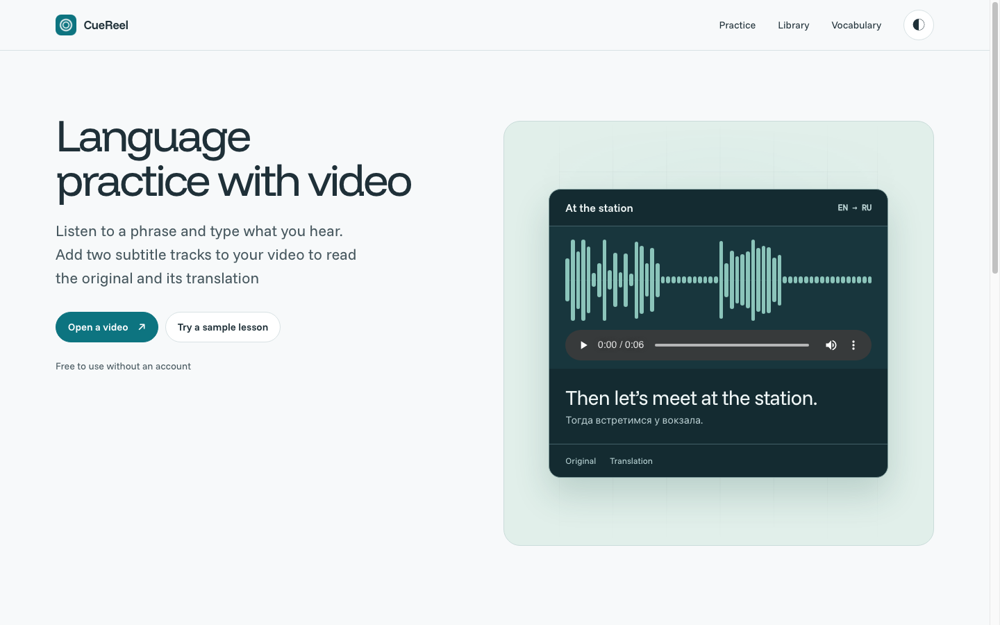

<div align="center">



# CueReel

**Učte sa jazyky s vlastným videom, zvukom a titulkami**

[](LICENSE)
[](https://developer.mozilla.org/en-US/docs/Web/JavaScript/Guide/Modules)
[](https://www.w3.org/TR/webvtt1/)
[](.github/workflows/pages.yml)

[English](README.md) · [Українська](README.uk.md) · **Slovenčina** · [Deutsch](README.de.md) · [Русский](README.ru.md)

</div>

---

## Prehľad

Sledujte video so synchronizovanými titulkami, prepisujte zobrazenú vetu alebo si precvičujte diktát. Aplikácia funguje v prehliadači bez účtu a časového limitu lekcie

---

## Funkcie

| | Funkcia | Podrobnosti |
|---|---|---|
| ▶️ | **Médiá** | Lokálne súbory, priame odkazy, YouTube, Vimeo, PeerTube a Internet Archive |
| 🌐 | **Titulky** | Originál a preklad z formátov SRT, WebVTT alebo podporovaných vložených textových stôp. Úprava textu a časových údajov, export do SRT alebo WebVTT |
| 🎙️ | **Prepis** | Viacjazyčný Whisper Base Q5 vytvára v zariadení pôvodnú stopu s časovými údajmi |
| ⌨️ | **Cvičenia** | Kontrola počas písania, automatický prechod po správnej odpovedi, pomôcky pri diktáte a voliteľné zvuky písania a chyby |
| 📊 | **Pokrok** | Počet zvládnutých viet, presnosť a čas počúvania. Kartičky so slovnou zásobou a plánované opakovanie |
| 💾 | **Ukladanie** | Automatické obnovenie aktuálnej lekcie, samostatné uložené lekcie a prenos knižnice cez zálohu JSON |
| ◐ | **Vzhľad** | Anglické rozhranie so svetlou a tmavou témou |

---

## Rýchly štart

```bash
python3 -m http.server 8000 --bind 127.0.0.1
```

Spustite príkaz v priečinku projektu a otvorte [127.0.0.1:8000](http://127.0.0.1:8000). Vyberte **Try a sample lesson** alebo pridajte médiá v časti **Lesson materials**

---

## Lokálne titulky a YouTube

Pri lokálnom videu alebo zvuku bez titulkov vyberte **Generate subtitles**. Pri prvom použití sa stiahne približne 60 MB váh modelu Whisper a prehliadač ich podľa možností uloží do vyrovnávacej pamäte. Zvuk zostáva v zariadení. Výsledok skontrolujete cez **Edit subtitles**

Odkaz na video YouTube, Shorts alebo youtu.be vložte do **Video or audio URL** a stlačte **Open link**. Na YouTube vyberte **Show transcript**, ak je táto možnosť dostupná. Skopírujte text s časovými údajmi do **Paste YouTube transcript** a vyberte **Use as original** alebo **Use as translation**. Pri videu bez titulkov otvorte lokálnu kópiu a použite Whisper

---

## Cvičenia a ukladanie

**Subtitle typing** aj **Dictation** prijímajú odpovede s interpunkciou aj bez nej. Zapnite **Typing sounds**, ak chcete pri nesprávnom znaku počuť odlišný zvuk

Po obnovení stránky sa v rovnakom prehliadači na rovnakej adrese obnovia médiá, stopy, pozícia, režim, odpoveď aj pokrok. **Save lesson** uloží pomenovanú kópiu do knižnice. **Library backup** obsahuje titulky, pokrok a slovnú zásobu. Po importe v inom prehliadači znova pripojte lokálne súbory

---

## Technológie a nasadenie

Aplikácia používa HTML, CSS, moduly JavaScript, IndexedDB, Web Audio a whisper.cpp skompilovaný do WebAssembly. Pre GitHub Pages vyberte **Settings → Pages → Source → GitHub Actions** a spustite **Deploy GitHub Pages**. [Workflow](.github/workflows/pages.yml) skopíruje statické súbory a prostredie potrebné na spustenie

---

## Obmedzenia

- YouTube a Vimeo musia povoľovať vloženie videa. Na stiahnutie titulkov cez [oficiálne API YouTube](https://developers.google.com/youtube/v3/docs/captions/download) potrebujete oprávnenie upravovať video
- Whisper potrebuje podporu WebAssembly SIMD a kompatibilný zvukový kodek. Dlhé súbory môžu vyžadovať viac času a pamäte
- Kapacita lokálnej knižnice závisí od úložiska prehliadača. Prístup k vzdialeným súborom a titulkom aj posun vo videu závisia od zdroja

## Plány

- [ ] Podpora ďalších platforiem a zdrojov titulkov

## Licencia

[MIT](LICENSE)
