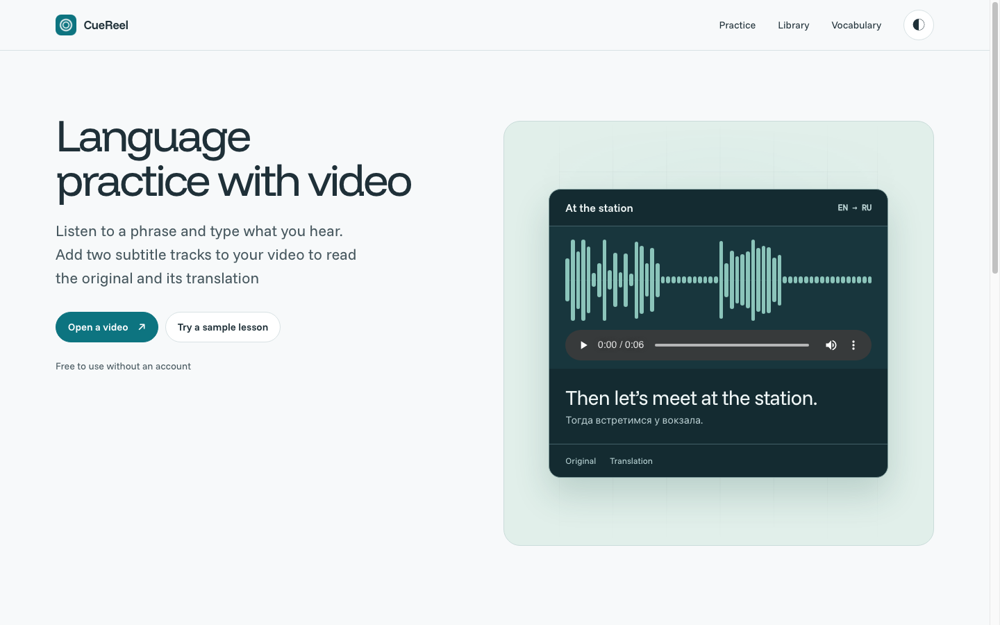

<div align="center">



# CueReel

**Вивчайте мови за власними відео, аудіо й субтитрами**

**[Спробувати CueReel онлайн](https://jarryuser.github.io/CueReel/)**

[](LICENSE)
[](https://developer.mozilla.org/en-US/docs/Web/JavaScript/Guide/Modules)
[](https://www.w3.org/TR/webvtt1/)
[](.github/workflows/pages.yml)

[English](README.md) · **Українська** · [Slovenčina](README.sk.md) · [Deutsch](README.de.md) · [Русский](README.ru.md)

</div>

---

## Огляд

Дивіться відео із синхронізованими субтитрами, набирайте видиму фразу або пишіть диктант. Застосунок працює у браузері без облікового запису й обмеження часу заняття

---

## Можливості

| | Можливість | Опис |
|---|---|---|
| ▶️ | **Медіа** | Локальні файли, прямі посилання, YouTube, Vimeo, PeerTube та Internet Archive |
| 🌐 | **Субтитри** | Оригінал і переклад із SRT, WebVTT або підтримуваних вбудованих текстових доріжок. Редагування тексту й таймкодів, експорт у SRT або WebVTT |
| 🎙️ | **Транскрипція** | Багатомовна Whisper Base Q5 створює на пристрої оригінальну доріжку з таймкодами |
| ⌨️ | **Вправи** | Перевірка під час набору, автоматичний перехід після правильної відповіді, підказки в диктанті й опційні звуки набору та помилки |
| 📊 | **Прогрес** | Кількість пройдених фраз, точність і час прослуховування. Збереження слів на картках та повторення за розкладом |
| 💾 | **Збереження** | Автоматичне відновлення робочого простору, окремі уроки в бібліотеці та перенесення бібліотеки через резервну копію JSON |
| ◐ | **Вигляд** | Англійський інтерфейс зі світлою й темною темами |

---

## Швидкий старт

```bash
python3 -m http.server 8000 --bind 127.0.0.1
```

Виконайте команду в папці проєкту й відкрийте [127.0.0.1:8000](http://127.0.0.1:8000). Виберіть **Try a sample lesson** або додайте медіа в **Lesson materials**

---

## Локальні субтитри та YouTube

Для локального відео чи аудіо без субтитрів виберіть **Generate subtitles**. Під час першого запуску браузер завантажує близько 60 МБ ваг Whisper і кешує їх, якщо є місце. Аудіо залишається на пристрої. Результат можна перевірити через **Edit subtitles**

Для YouTube вставте посилання на звичайне відео, Shorts або youtu.be у **Video or audio URL** і натисніть **Open link**. На YouTube відкрийте **Show transcript**, якщо ця дія доступна. Вставте текст із таймкодами в **Paste YouTube transcript** і виберіть **Use as original** або **Use as translation**. Для відео без субтитрів відкрийте локальну копію й скористайтеся Whisper

---

## Вправи та збереження

**Subtitle typing** і **Dictation** приймають відповіді з розділовими знаками й без них. Увімкніть **Typing sounds**, щоб чути окремий звук, коли символ не збігається

Після перезавантаження в тому самому браузері й на тій самій адресі відновлюються медіа, доріжки, позиція, режим, відповідь і прогрес. **Save lesson** зберігає іменовану копію в бібліотеці. **Library backup** містить субтитри, прогрес і словник. Після імпорту в інший браузер підключіть локальні файли знову

---

## Технології та публікація

Застосунок використовує HTML, CSS, модулі JavaScript, IndexedDB, Web Audio та whisper.cpp, зібраний у WebAssembly. Для GitHub Pages виберіть **Settings → Pages → Source → GitHub Actions** і запустіть **Deploy GitHub Pages**. [Робочий процес](.github/workflows/pages.yml) копіює статичні файли та середовище виконання

---

## Обмеження

- YouTube і Vimeo мають дозволяти вбудовування відео. Для завантаження субтитрів через [офіційний API YouTube](https://developers.google.com/youtube/v3/docs/captions/download) потрібні права на редагування відео
- Whisper потребує підтримки WebAssembly SIMD і кодека аудіодоріжки у браузері. Довгі файли можуть потребувати більше часу й пам’яті
- Обсяг локальної бібліотеки залежить від сховища браузера. Доступ до зовнішніх файлів, доріжок і перемотування залежить від джерела

## Плани

- [ ] Підтримка додаткових платформ і джерел субтитрів

## Ліцензія

[MIT](LICENSE)
